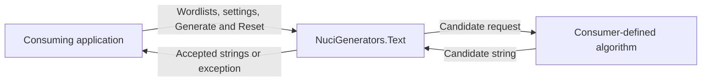
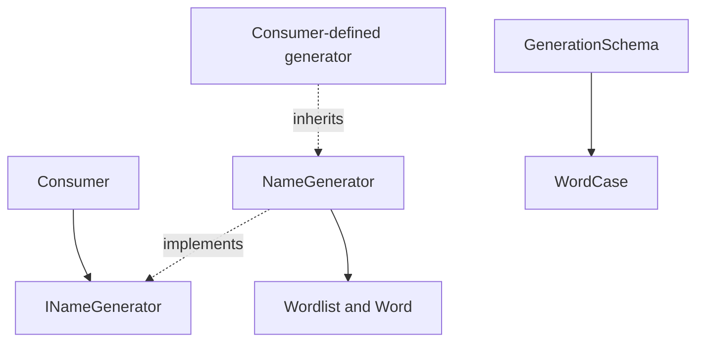
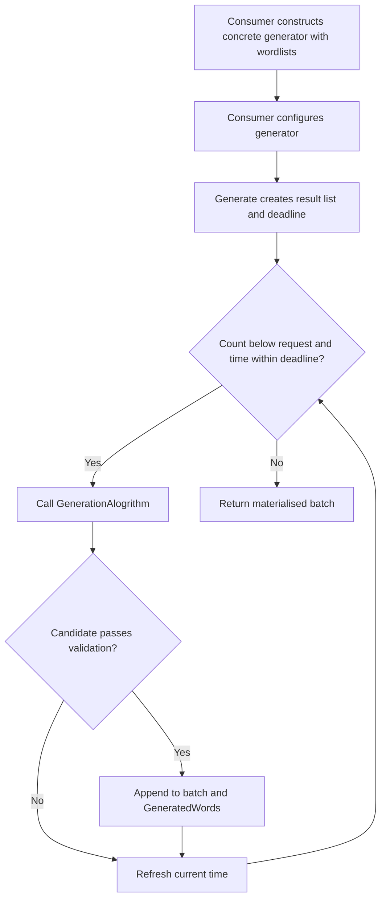
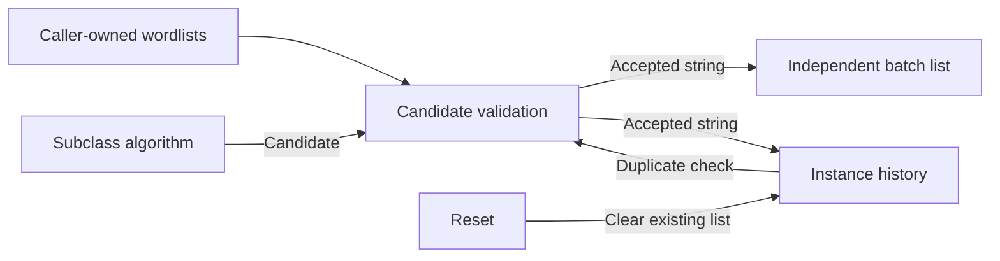
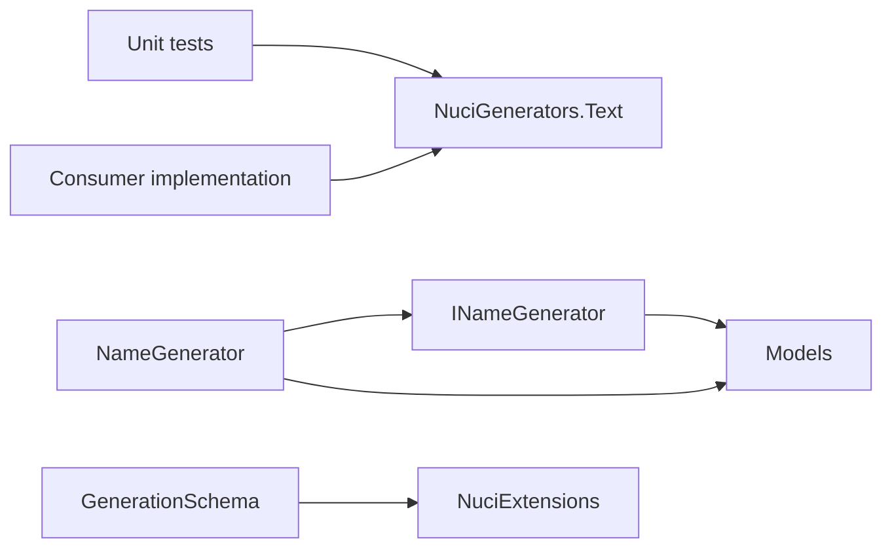

# NuciGenerators.Text Architecture

This document describes the current architecture of the .NET text-generation library, its public extension contract, and its in-memory state. Consumer-specific generation algorithms and application infrastructure are outside its implementation boundary.

## 📑 Table of Contents

- [Purpose](#purpose)
- [System Context](#system-context)
- [Architectural Style](#architectural-style)
- [Runtime Flow](#runtime-flow)
- [Components](#components)
- [Data Architecture](#data-architecture)
- [Interfaces and Integrations](#interfaces-and-integrations)
- [Cross-Cutting Concerns](#cross-cutting-concerns)
  - [Security and Privacy](#security-and-privacy)
  - [Error Handling](#error-handling)
  - [Configuration](#configuration)
  - [Concurrency and Resource Use](#concurrency-and-resource-use)
- [Dependency Direction and Rules](#dependency-direction-and-rules)
- [External Dependencies](#external-dependencies)
- [Deployment and Operations](#deployment-and-operations)
- [Compatibility Contracts](#compatibility-contracts)
- [Testing and Verification](#testing-and-verification)
- [Design Constraints](#design-constraints)
- [Extension Points](#extension-points)
  - [Name Generation](#name-generation)
- [Source Map](#source-map)
- [Related Documentation](#related-documentation)

## 🎯 Purpose

NuciGenerators.Text supplies reusable contracts, candidate validation, generation history, and word models for specialised generators. This document helps contributors distinguish library responsibilities from those of consuming applications and preserve observable contracts when changing either boundary.

## 🌐 System Context

The library executes inside a consuming .NET process. The consumer supplies wordlists, settings, and a concrete generation algorithm; it receives generated strings. The repository supplies no application entry point, database, network endpoint, or built-in persistence adapter.



The principal external boundaries are:
- **Consumer Process:** Owns construction, execution, input provenance, output use, and any persistence or transmission.
- **Generation Algorithm:** Consumer-defined code runs synchronously inside the generation operation; its exceptions and execution cost affect the caller directly.

## 🏗️ Architectural Style

The library uses interface-based consumption and an abstract template method. `NameGenerator` implements orchestration and validation while delegating candidate construction to its protected abstract `GenerationAlogrithm()` method. Models are mutable data containers, not a schema execution engine.



The principal architecture boundaries are:
- **Public Contract:** `INameGenerator` exposes settings, collections, generation, and reset operations.
- **Generation Orchestration:** `NameGenerator` owns acceptance rules and history; subclasses own candidate construction.
- **Models:** Word collections and schema metadata are independent of generator orchestration.

## 🔄 Runtime Flow



The principal runtime sequence is:
1. The consumer constructs a subclass with a `List<Wordlist>` retained by reference and configures its public properties.
2. `Generate(maximumCount)` creates a separate result list and calculates a deadline using `DateTime.Now` plus `MaxProcessingTimePerWord * maximumCount` milliseconds.
3. Each iteration obtains a candidate synchronously, then checks whitespace, inclusive length bounds, literal prefix and suffix, previous results, seed values, excluded regex patterns, and required regex patterns, in that order.
4. Accepted strings enter both the current batch and persistent instance history. Rejected candidates do not change history; generation continues until the count or deadline condition terminates iteration.
5. The materialised batch is returned. A later `Reset()` clears the existing history list without changing settings, wordlists, or previously returned batches.

## 🧩 Components

| Component | Responsibility | Principal Dependencies | Lifetime or Ownership |
|-----------|----------------|------------------------|-----------------------|
| `INameGenerator` | Consumer-facing generation contract | Word models and BCL collections | Implemented by consumer-selected generators |
| `NameGenerator` | Iteration, filtering, history, and reset | `INameGenerator`, word models, `Random`, regex and clock APIs | Consumer-owned instance with mutable state |
| `Wordlist` | Literal identifier lookup and word enumeration | `Dictionary<string, Word>` | Retains supplied word instances |
| `Word` | Identifier and enumerable string values | BCL collections | Mutable consumer-provided object |
| `GenerationSchema` and `WordCase` | Metadata, annotation constraints, equality, and casing selection | Data annotations and NuciExtensions | Consumer-owned metadata; not executed by the base generator |

## 💾 Data Architecture

State is held in memory. Constructor inputs and word instances are not defensively copied. Consumers can mutate the exposed lists, including generation history; subsequent validation observes those changes. No database schema or migration mechanism is implemented.



| Data or Store | Owner | Representation and Storage | Lifecycle or Consistency |
|---------------|-------|----------------------------|--------------------------|
| `Wordlists` | Consumer and generator share the supplied list | In-memory list of keyed word collections | Consumer mutations remain visible to validation |
| `GeneratedWords` | Generator instance; also publicly mutable | In-memory `List<string>` | Accumulates accepted strings until cleared or modified |
| Generation batch | Calling operation | Separate in-memory list returned as `IEnumerable<string>` | Materialised before return; unaffected by later reset |
| `GenerationSchema` | Consumer | Mutable metadata and annotation attributes | Equality and hashing use `Id`, `Name`, `Schema`, and `FilterlistPath`, not `Category` or `WordCase` |

## 🔌 Interfaces and Integrations

| Interface or Integration | Direction | Contract | Owner | Failure Semantics |
|--------------------------|-----------|----------|-------|-------------------|
| `INameGenerator.Generate(int)` | Inbound | Synchronous materialised batch of up to the requested count | Generator implementation | Base implementation propagates algorithm and validation exceptions |
| `INameGenerator.Reset()` | Inbound | Clear generated history | Generator implementation | Base implementation clears the existing list in place |
| `GenerationAlogrithm()` | Outbound callback | Protected abstract candidate-generation method | Consumer subclass | Exceptions propagate without rollback of earlier history |
| `Wordlist.Add` and `Get` | Inbound | Dictionary-backed insertion and identifier lookup | `Wordlist` | Duplicate keys, absent keys, and invalid arguments use underlying collection exceptions |

There are no built-in remote service integrations. `GenerationSchema.FilterlistPath` is metadata; this library does not load the referenced file.

## 🧵 Cross-Cutting Concerns

### Security and Privacy

The consumer controls input strings and regex patterns. These can contain personal data; the library does not classify or anonymise them. Repository-owned generation code performs no explicit network transfer or file persistence. Subclasses may introduce either operation and remain the consumer's responsibility. Regex calls do not specify a per-call timeout, so untrusted patterns require particular care.

### Error Handling

There is no exception translation or retry policy. Rejection of a candidate is normal control flow, but malformed regex patterns or subclass failures terminate the operation. Strings accepted earlier in that operation remain in history even when no batch is returned due to an exception. Annotation constraints on schema metadata require explicit validation by the consumer; property assignment does not enforce them.

### Configuration

| Configuration Area | Source | Responsibility | Override or Secret Policy |
|--------------------|--------|----------------|---------------------------|
| Length and batch budget | Mutable public properties | Defaults: minimum length 5, maximum length 10, budget 1000 milliseconds per requested word | Consumer assigns properties directly; no configuration-file precedence |
| Literal and regex filters | Mutable strings and lists | Empty prefix, suffix, and pattern lists initially impose no corresponding restriction | Caller-provided patterns execute as .NET regular expressions |
| Seed exclusion | `NameGenerator.OnlyNewNames` | Defaults to `true`; excludes exact seed values | Concrete base-class property, absent from `INameGenerator` |

### Concurrency and Resource Use

Generation is synchronous, with no locking, asynchronous API, cancellation, or disposal contract. Exposed mutable collections are not protected against concurrent access. Consumers should serialise operations on an instance and coordinate access to shared wordlists. The deadline is checked between candidates, not during algorithm execution or regex evaluation; it is not a hard execution limit. History has no automatic capacity bound or expiry.

## 🧭 Dependency Direction and Rules

Production orchestration depends on the public contract and word models. Models do not depend on orchestration. The test project references production, never the reverse.



The principal dependency rules are:
- Consumer-specific algorithms extend the public generation boundary rather than being embedded in the shared base class.
- Models remain independent of generator orchestration; production code must not depend on test implementations.
- Application hosting, input loading, persistence, and transport remain outside the current shared-library boundary.

## 📦 External Dependencies

| Dependency | Responsibility | Integration Boundary | Architectural Consequence |
|------------|----------------|----------------------|---------------------------|
| .NET 10 BCL | Collections, random values, clock, regex, and annotations | Production library | Both projects target `net10.0` |
| NuciExtensions 5.3.1 | `NotEquals` type comparison in schema object equality | `GenerationSchema.Equals(object)` | Direct production package dependency |
| NUnit, NUnit3TestAdapter, and Microsoft.NET.Test.Sdk | Test definition, discovery, and execution | Unit-test project | Test-only dependencies |
| coverlet.collector | Optional coverage collection | Unit-test project | Test-only tooling; not runtime instrumentation |

## 🚀 Deployment and Operations

The deployment unit is a .NET class library consumed as a package or project reference, not a standalone process. The production manifest declares package version `1.0.1` and disables automatic package generation during builds. The configured CI workflow restores, builds, and tests the solution; it does not publish a package.

| Concern | Current Design | Architectural Consequence |
|---------|----------------|---------------------------|
| Process topology | Runs in the consumer's process | Consumer owns startup, shutdown, and exception handling |
| State and persistence | Instance history and caller-supplied collections in memory | No built-in cross-process duplicate prevention or durable history |
| Parallel execution | No shared-state synchronisation | Consumer owns instance isolation and shared-input coordination |
| Diagnostics | No library logging or metrics implementation | Consumer supplies operational diagnostics |

## 🛡️ Compatibility Contracts

| Contract | Owner | Invariant | Verification | Change Policy |
|----------|-------|-----------|--------------|---------------|
| `GenerationAlogrithm()` | `NameGenerator` and subclasses | Existing misspelled protected method name is the extension signature | Scripted subclass compilation | Renaming would require a compatibility plan for existing subclasses |
| Candidate acceptance | Base generator | Case-sensitive literal filters; exact history and seed comparisons; all required patterns and no excluded matches | Validation tests | Preserve observable rules unless intentionally changing the contract |
| History and reset | Base generator | Reset clears the same list; earlier returned batches remain independent | Generation tests | Preserve collection identity and mutation semantics |
| Schema equality | `GenerationSchema` | Category and casing do not participate | Schema tests | Equality changes affect hashed collections and consumers |
| `WordCase` | Public model | Declaration order assigns `Original=0`, `Lower=1`, `Upper=2`, `Title=3`, `Sentence=4` | Source inspection; no dedicated enum-contract tests | Preserve numeric values for consumers relying on them |

## ✅ Testing and Verification

The NUnit unit-test project uses a queue-driven subclass to test the base algorithm boundary deterministically. Tests cover candidate filtering, generation history, reset identity, propagated exceptions, shared inputs, wordlist lookup and enumeration, and schema equality and annotations. These are behavioural tests, not architecture fitness tests. Concurrent use, hard timing guarantees, and application-specific algorithms are not established by this suite.

Execute the principal automated verification with:

```bash
dotnet test NuciGenerators.Text.slnx
```

## ⚠️ Design Constraints

- **No Concrete Generator:** Consumers must supply an algorithm; schema metadata does not produce text by itself.
- **Cooperative Deadline:** Wall-clock checks occur between candidates, and budget multiplication uses integer arithmetic. Long operations, clock changes, and extreme inputs prevent a hard latency guarantee.
- **Mutable Shared State:** External changes to inputs and history affect future validation; there is no defensive copying or transaction rollback.
- **Validation Cost:** History lookup and seed scans are linear searches; regex evaluation is repeated for candidates without an explicit per-call timeout.
- **Metadata Only:** Casing and filterlist metadata are not interpreted by the base generation pipeline.

## 🔧 Extension Points

### Name Generation

1. Derive from `NameGenerator` and pass the consumer's wordlist collection to its constructor, or implement `INameGenerator` independently.
2. For a subclass, implement `GenerationAlogrithm()` and construct the implementation in the consuming application; no registration container is provided.
3. Test candidate production together with inherited validation, history, and failure semantics.

Subclasses can use the protected `random` field and `IsNameValid` method. Candidate production is synchronous; returning a string does not bypass base validation. Independent interface implementations own their own orchestration rather than inheriting base-class guarantees.

## 🗺️ Source Map

| Area | Path |
|------|------|
| Public contract | [INameGenerator.cs](./NuciGenerators.Text/INameGenerator.cs) |
| Generation orchestration | [NameGenerator.cs](./NuciGenerators.Text/NameGenerator.cs) |
| Data models | [Models](./NuciGenerators.Text/Models/) |
| Production package | [NuciGenerators.Text.csproj](./NuciGenerators.Text/NuciGenerators.Text.csproj) |
| Behavioural verification | [Unit Tests](./NuciGenerators.Text.UnitTests/) |
| Solution | [NuciGenerators.Text.slnx](./NuciGenerators.Text.slnx) |
| Continuous integration | [dotnet.yml](./.github/workflows/dotnet.yml) |

## 📚 Related Documentation

- [README](./README.md): Package orientation and usage examples.
- [Contributing Guidelines](./CONTRIBUTING.md): Contribution and development procedures.
- [Security Policy](./SECURITY.md): Vulnerability reporting and maintenance policy.
- [Privacy and Personal Data](./PRIVACY.md): Published data-handling description; actual input content and downstream processing remain consumer-controlled.
