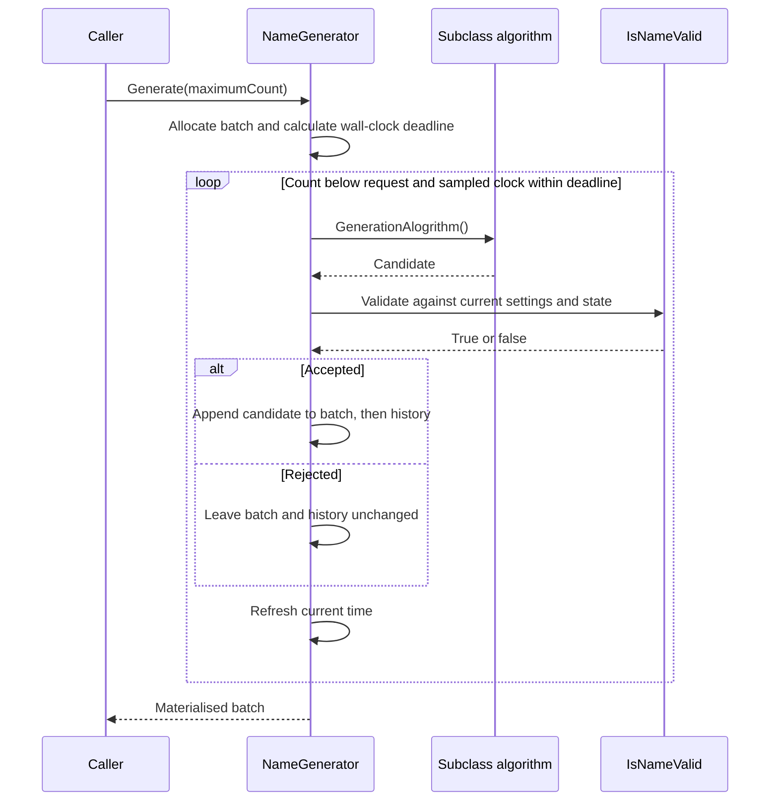

# Generation flow

## Call-to-result trace

Entry: `NuciGenerators.Text.NameGenerator.Generate(int maximumCount)` in [source](../../NuciGenerators.Text/NameGenerator.cs). The only repository-owned concrete caller context is [the unit tests](../../NuciGenerators.Text.UnitTests/NameGeneratorTests.cs); production consumers construct their own subclasses.

## Why each dependency is required

The subclass provides information absent from the shared library: how a candidate is formed. Validation requires current settings, current history, and optionally seed values to decide whether that candidate is permissible. Only accepted strings are committed so future attempts and later batches can exclude them. The independent batch exists to return this invocation's results without exposing the entire history as its result.

## Alternative exits

| Cause | Algorithm called? | Return or failure | State |
|-------|-------------------|-------------------|-------|
| Nonpositive request | No | Empty batch after setup | Existing history unchanged |
| Initially expired deadline | No | Empty batch | Existing history unchanged |
| Target count reached | Yes, as needed | Accepted batch | Accepted strings appended |
| Deadline reached between iterations | Possibly | Partial or empty batch | Earlier accepted strings retained |
| Algorithm, enumeration, or regex exception | Until failure | Exception; no returned batch | Earlier accepted strings retained |

Deadline setup still occurs for nonpositive requests; the method does not establish a general input-validation contract. Unexpected exceptions are not converted into an empty result.

## Invariant and modification impact

For a normally returned batch under stable, non-re-entrant inputs, each result passed validation at acceptance and was appended to history in the same order. This does not imply durable storage, hard timeout enforcement, or continued validity after configuration changes. [Tests](../../NuciGenerators.Text.UnitTests/NameGeneratorTests.cs) verify the standard sequence and exception side effects. Changing append order, evaluation order, or early exits requires revisiting [History behaviour](../behaviour/batch-and-history.md), [Errors](../error-handling.md), and consumers' retry policies.
