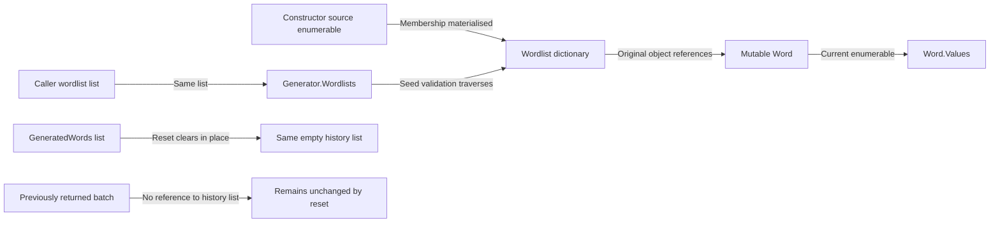

# Mutation and reset flow

## Reference graph

## Causal examples

1. Construct a generator with an empty list; then append a wordlist containing `Oscar` to that same caller list. Default `OnlyNewNames=true` now causes `Oscar` to be rejected. Construction did not freeze seed input.
2. Construct a wordlist from a caller list of words; clear that source list. The wordlist retains its original membership because construction materialised a dictionary.
3. Replace a stored word's values with `Robert`. Future seed checks see `Robert`, not the earlier sequence; object references were retained.
4. Change a stored word's identifier from `original` to `changed`. Dictionary lookup still requires `original`, while the returned object's identifier reads `changed`. There is no reindexing callback.
5. Generate a batch and retain both the batch and history references. Reset makes the retained history reference empty but leaves the batch intact. A previously accepted candidate can subsequently pass the history check again.

## Source, tests, and impact

[Wordlist implementation](../../NuciGenerators.Text/Models/Wordlist.cs) and [generator implementation](../../NuciGenerators.Text/NameGenerator.cs) deliberately have different copying boundaries. [Collection tests](../../NuciGenerators.Text.UnitTests/Models/WordlistTests.cs) prove examples 2 through 4 and live values views. [Generation tests](../../NuciGenerators.Text.UnitTests/NameGeneratorTests.cs) prove examples 1 and 5.

The preserved invariant is identity-specific, not general immutability: membership is copied at wordlist construction, words remain shared, the generator retains its outer list, and reset clears history without replacing it. Refactoring any one boundary requires checking all aliases rather than merely comparing returned strings.
