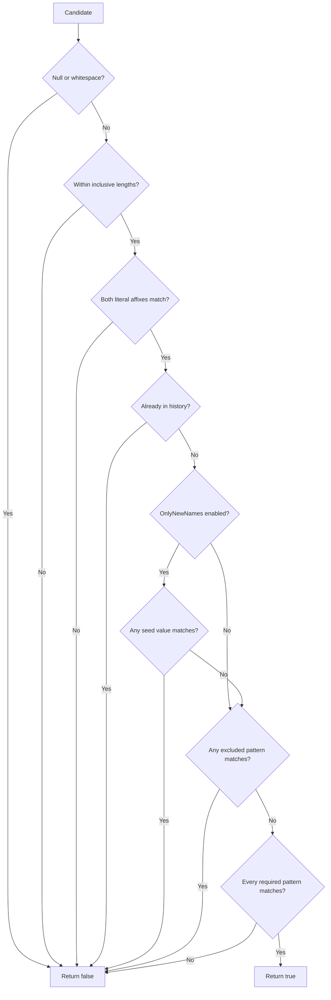

# Validation flow

## Decision path

[Source](../../NuciGenerators.Text/NameGenerator.cs): `NuciGenerators.Text.NameGenerator.IsNameValid`. See [Acceptance rules](../behaviour/candidate-acceptance.md) for comparison and Unicode details.

## Errors depend on reachability

Null or too-short candidates return false even if regex lists contain invalid syntax. A candidate satisfying earlier rules can expose the invalid syntax and throw. A matching first exclusion suppresses later exclusions and all inclusions. A failing first inclusion suppresses later inclusions. Null seed collections are not traversed when seed exclusion is off. These branches are important when diagnosing why one input throws while another simply disappears.

Validation performs no base-owned history mutation. However, `NuciGenerators.Text.Models.Word.Values` accepts arbitrary enumerable implementations, so enumeration can run consumer code, throw, or mutate other state. No catch isolates that boundary. A true return means acceptance at that moment, not a lock on inputs or a reservation of the string.

## Tests and preserved invariant

[Validation tests](../../NuciGenerators.Text.UnitTests/NameGeneratorValidationTests.cs), especially `NuciGenerators.Text.UnitTests.NameGeneratorValidationTests.GivenAnInvalidNameAndMalformedPatterns_WhenValidating_ThenLengthGuardsRunFirst` and `GivenACandidate_WhenValidatingRepeatedly_ThenHistoryIsNotModified`, corroborate early guards and history purity. Pattern-list short-circuit failure masking follows the source's `Any`/`All` evaluation; not every malformed-list permutation is separately tested.

The invariant is ordered, conjunctive acceptance, with ordinary rejection distinguishable from exceptional configuration or dependency failure. Parallelising or reordering checks can change error semantics and enumeration effects. See [Change guide](../change-guide.md).
